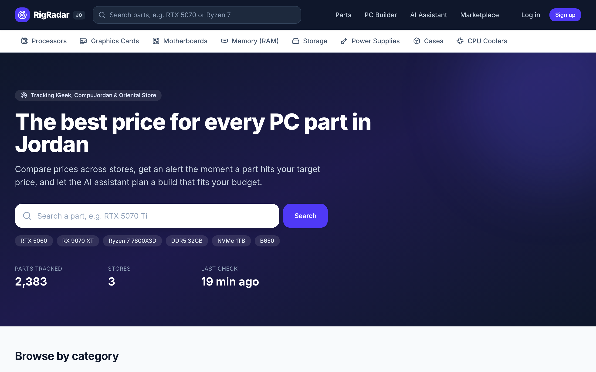
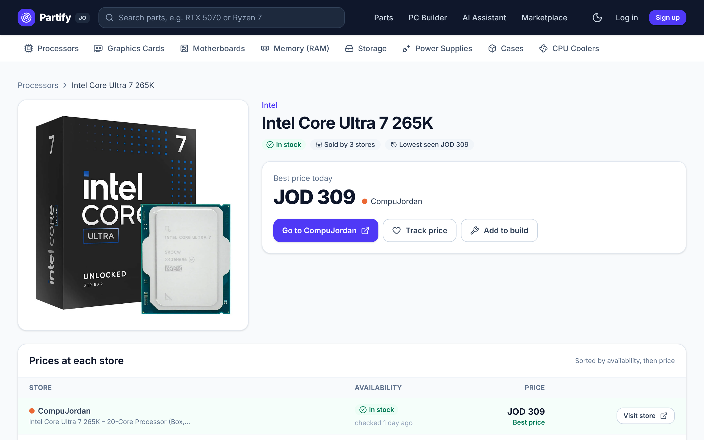
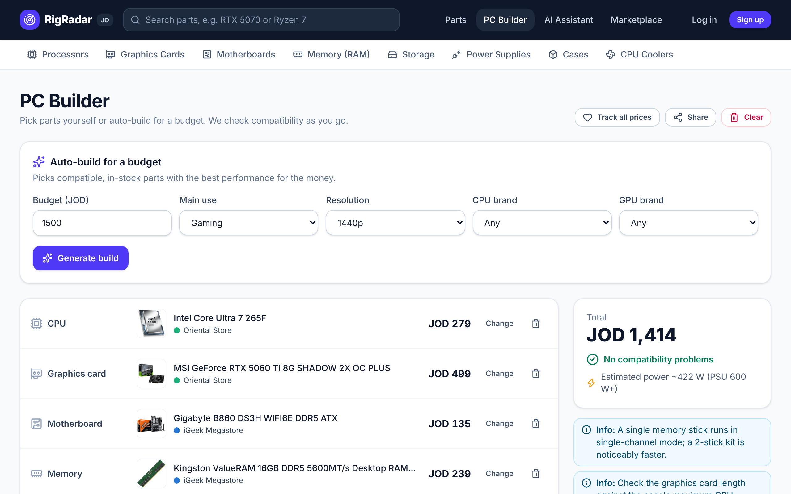
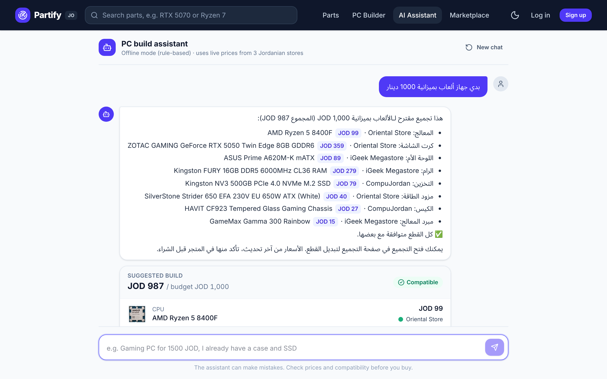
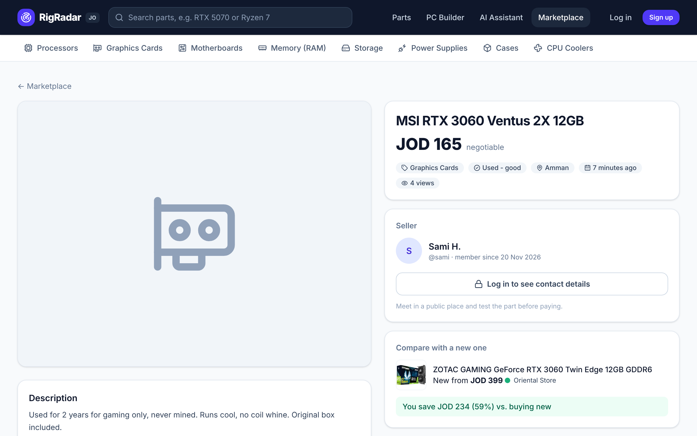
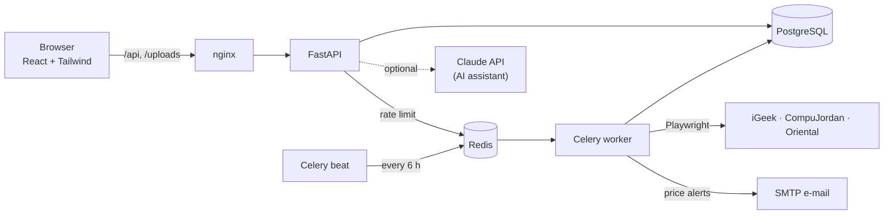

# RigRadar 🇯🇴 — PC part price comparison for Jordan

RigRadar compares PC-part prices across three Jordanian stores, tracks every price
change, alerts users when a part reaches their target price, helps them plan a build
with an AI assistant, and lets them sell their own used parts.



| | |
|---|---|
|  |  |
|  |  |

## Features

- **Price comparison** – one page per part with every store's price, stock status and a link to buy.
  2,300+ parts in 8 categories (CPU, GPU, motherboard, RAM, storage, PSU, case, cooler), with filters
  (socket, GPU chip, VRAM, DDR type, wattage…), sorting and search.
- **Price history** – every price/stock change is stored; each product shows a per-store chart (and a table view).
- **Wishlist & price alerts** – track a part with an optional target price. When a scrape finds the
  price at or below the target (or the part comes back in stock) the user gets an in-app notification
  and an e-mail. Alerts fire once and re-arm when the price goes back up (no spam).
- **AI build assistant** – chat in English or Arabic. It uses Claude with tools that query *our*
  database (search parts, recommend a build, check compatibility…), so it never invents prices.
  Without an API key it falls back to a free rule-based assistant.
- **PC builder** – pick parts with live compatibility checks (socket, DDR4/DDR5, case size, PSU
  wattage, graphics output) or auto-build for a budget and use case.
- **Marketplace & profiles** – users list items for sale with photos, condition, city and price;
  every user has a public profile with their listings. Linked catalog products show how much a buyer
  saves versus buying new.
- **Admin dashboard** – scrape history, per-store stats and a "scrape now" button.
- **Dark mode** – follows your system setting; the sun/moon button in the header switches it and
  remembers your choice. The price chart uses its own validated dark-mode colours.

## The three stores (and why these three)

| Store | Platform | How we scrape it | robots.txt |
|---|---|---|---|
| **iGeek Megastore** – igeekjo.com | Shopify | Public JSON product feed (`/collections/<x>/products.json`) – no HTML parsing | allowed |
| **CompuJordan** – compujordan.com | OpenCart | Playwright renders category pages, 100 products per page | everything allowed except `/admin/` |
| **Oriental Store** – os-jo.com | OpenCart (custom theme) | Playwright renders category pages and follows `rel="next"` pagination | categories and `?page=` allowed; search/sort/filter disallowed (we never use them) |

All three are well-known PC stores in Amman with large component catalogs, prices in JOD and
**no bot protection** – and each one shows a different scraping technique. Big US stores were
tested first and rejected: Newegg and Micro Center sit behind Cloudflare bot challenges, and eBay's
robots.txt forbids crawling search pages. City Center (citycenter.jo) is very popular but its
robots.txt blocks search *and* pagination for bots. Full analysis: [docs/SCRAPING.md](docs/SCRAPING.md).

## Architecture



| Layer | Technology |
|---|---|
| Frontend | React 19, React Router, Tailwind CSS 4, Recharts, Vite |
| API | FastAPI, Pydantic v2, SQLAlchemy 2, Alembic, JWT auth (Argon2 password hashing) |
| Database | PostgreSQL 16 (JSONB for part specs) |
| Background jobs | Celery 5 + Redis (worker + beat scheduler) |
| Scraping | Playwright (Chromium) + BeautifulSoup |
| AI | Anthropic Claude (`claude-opus-5-5`) with tool use; rule-based fallback |

## Quick start (Docker)

```bash
cp .env.example .env          # set SECRET_KEY and ADMIN_PASSWORD at least
docker compose up --build
```

| URL | What |
|---|---|
| http://localhost:8080 | the website |
| http://localhost:8000/docs | interactive API documentation |
| http://localhost:8025 | Mailpit – every e-mail the app sends (price alerts) lands here |

On first start the database is migrated and filled with a **real snapshot** of the three stores
(taken 20 Nov 2026), so the site works immediately – even offline. The worker scrapes the stores
every 6 hours; to scrape now, log in as the admin (from `.env`) and press **Scrape all stores now**
on `/admin`, or run `docker compose exec worker python3 -m app.cli scrape all`.

Demo accounts (when `SEED_DEMO_USERS=true`): `sami`, `lina`, `omar` – password `demo12345`.
Turn this off on any public server.

To enable the AI assistant, put an Anthropic API key in `.env` (`ANTHROPIC_API_KEY=...`) and restart.

## Live updates: GitHub → running website

To have the website update itself whenever new code is pushed to GitHub, start it with one command
instead of `docker compose up`:

```bash
git clone https://github.com/<you>/rigradar.git && cd rigradar    # once
bash scripts/live.sh                                              # Git Bash / Linux / macOS
```

```
push to GitHub ──► scripts/auto-pull.sh (checks every 15 s, git pull)
                        └─► docker compose --watch applies the changed files
                              Python code   → copied into the containers + restart   (seconds)
                              React code    → frontend image rebuilt                 (~30 s)
                              requirements  → backend image rebuilt                  (~1-2 min)
```

Database migrations (Alembic) run automatically each time the API restarts. Keep the terminal open;
Ctrl+C stops both the updater and the website. If you edit files in that folder yourself, `git pull`
may refuse to fast-forward - commit or discard your edits first.

> This deploys *whatever is on `main`*. Run `pytest` before pushing, and never point the updater at a
> repository other people can push to.

## Local development (without Docker)

You need Python 3.12+, Node 20+, PostgreSQL 16 and Redis 7
(or just `docker compose up db redis mailpit` for the services).

```bash
# 1. database (once)
sudo -u postgres psql -c "CREATE USER rigradar WITH PASSWORD 'rigradar' CREATEDB;"
sudo -u postgres psql -c "CREATE DATABASE rigradar OWNER rigradar;"
```

```bash
# 2. backend
cd backend
python -m venv .venv && source .venv/bin/activate     # Windows: .venv\Scripts\activate
pip install -r requirements.txt
playwright install chromium
cp ../.env.example .env                               # defaults point at localhost
python -m app.cli init                                # migrations + seed
uvicorn app.main:app --reload                         # http://localhost:8000/docs
```

```bash
# 3. background jobs (two more terminals, inside backend/ with the venv active)
celery -A app.celery_app worker -Q scraping,default -c 2 -l info   # Windows: add --pool=solo
celery -A app.celery_app beat -l info
```

```bash
# 4. frontend
cd frontend
npm install
npm run dev                                           # http://localhost:5173
```

Useful commands (run in `backend/`):

| Command | What it does |
|---|---|
| `python -m app.cli scrape all` | scrape all stores now (no Celery needed) |
| `python -m app.cli scrape igeek --categories cpu,gpu` | one store, some categories |
| `python -m app.cli rematch` | redo cross-store product matching after improving the rules – no scraping |
| `python -m app.cli create-admin --email you@x.com --password ...` | make an admin |
| `python -m app.cli export-snapshot` / `import-snapshot` | save / load the demo data |
| `alembic revision --autogenerate -m "..."` | new migration after changing `models.py` |

## How it works

### Scraping pipeline
`app/scraping/` – Celery beat queues `scrape_all_stores` every 6 hours; the worker runs the stores
one after another (a Redis lock prevents two scrapes at once).

1. **Fetch** – `base.PoliteBrowser` wraps one Playwright Chromium for the whole run and enforces the
   rules in one place: robots.txt check for every URL (`robots.py`, RFC 9309 wildcards), 2.5 s+ pause
   between requests to a store, images/fonts/CSS/third-party trackers blocked, and an immediate stop
   on a bot challenge, 403 or 429 – we never try to get around a block.
2. **Parse** – each store module has a *pure* function (HTML/JSON in → items out), tested against
   real saved pages in `tests/fixtures/`.
3. **Understand** – `normalize.py` turns titles like *"AMD Ryzen 7 7800X3D Processor – 8 Cores, 96MB
   Cache, AM5, Tray"* into specs (socket, cores, VRAM, DDR type, wattage…) and a matching key. It also
   rejects things that are not real parts of the category (case fans in coolers, USB drives in storage,
   laptop RAM).
4. **Match** – `matching.py` decides whether listings from different stores are the same product
   (same key + same variant flags + same model codes + fuzzy-similar model words). It prefers missing
   a match over a wrong match: comparing prices of two different cards would mislead users.
5. **Save** – `pipeline.py` updates offers, writes a `price_history` row for every change, marks
   listings that disappeared, refreshes each product's best price, then checks wishlist alerts.

### Price alerts
`app/services/alerts.py` – runs after every scrape for the products whose price/stock changed.
A target-price alert fires once when the best **in-stock** price reaches the target, then re-arms only
when the price goes back above it. Without a target, users are told about drops of 5% or more.
Back-in-stock alerts are optional. E-mails are sent by a separate Celery task.

### Build recommender & compatibility
`app/services/recommender.py` splits the budget by use case (a gaming PC spends ~40% on the GPU),
picks the best performance per JOD in dependency order (GPU → CPU → board with the same socket →
RAM of the board's DDR type → storage → PSU sized for CPU+GPU → case that fits the board → cooler for
the CPU's heat), then balances: over budget → cheapen the supporting parts first, then the less
important big part; money left → upgrade the part that matters most. Performance indexes come from
`app/data/specs_db.py` (approximate, from public review averages).
`app/services/compatibility.py` holds the rules shared by the builder, the recommender and the chatbot.

### AI assistant
`app/services/chatbot.py` – the browser sends the conversation to `POST /api/chat`. With an API key,
FastAPI runs a tool-use loop with Claude: the model calls `search_parts`, `recommend_build`,
`check_compatibility`, `get_product` or `search_marketplace`, our code runs them against PostgreSQL and
sends the results back, and the final answer references products as `[[product:ID]]`, which the
frontend turns into live price links. Settings: `CHAT_MODEL` (default `claude-opus-5-5`),
`CHAT_EFFORT` (default `low` – fast replies), `CHAT_FALLBACKS` (default on: if a safety classifier
wrongly declines a request, the API retries it on a fallback model). The endpoint is rate limited
per user/IP. Without a key, or if the API is unreachable, a rule-based assistant that understands
budgets, use cases and resolutions in English and Arabic answers with the same recommender.

## API overview
Full interactive docs at `/docs` (use **Authorize** to log in).

| Area | Endpoints |
|---|---|
| Auth | `POST /api/auth/register`, `POST /api/auth/login`, `GET /api/auth/me` |
| Catalog | `GET /api/categories`, `GET /api/products` (filters `q`, `category`, `brand`, `store`, `min_price`, `max_price`, `in_stock`, `spec_<key>`, `sort`), `GET /api/products/facets`, `GET /api/products/{id}`, `GET /api/products/{id}/history`, `GET /api/products/{id}/similar`, `GET /api/deals`, `GET /api/stores` |
| Wishlist | `GET/POST /api/wishlist`, `PATCH/DELETE /api/wishlist/{id}` |
| Notifications | `GET /api/notifications`, `GET /api/notifications/unread-count`, `POST /api/notifications/{id}/read`, `POST /api/notifications/read-all` |
| Builder | `POST /api/builds/check`, `POST /api/builds/recommend` |
| Assistant | `POST /api/chat` |
| Marketplace | `GET/POST /api/listings`, `GET/PATCH/DELETE /api/listings/{id}`, `POST /api/listings/{id}/images`, `DELETE /api/listings/{id}/images/{image_id}` |
| Users | `GET /api/users/{username}`, `PATCH /api/users/me`, `POST /api/users/me/avatar`, `POST /api/users/me/password` |
| Admin | `GET /api/admin/stats`, `GET /api/admin/scrape-runs`, `POST /api/admin/scrape` |

## Tests

```bash
cd backend
createdb -U rigradar rigradar_test       # once (or set TEST_DATABASE_URL)
pytest                                   # 49 tests
```

They cover the three parsers (on real saved store pages), robots.txt rules, title normalisation and
matching, the scrape pipeline, price alerts, the HTTP API (auth, catalog, wishlist, notifications,
marketplace with image uploads, builder) and the chatbot's tool loop (with a stub Claude client –
no API key or network needed).

## Project structure

```
backend/
  app/
    main.py              FastAPI app        models.py      database tables
    config.py            settings (.env)    schemas.py     API request/response shapes
    celery_app.py        Celery + schedule  tasks.py       background jobs
    cli.py               command line       seed.py        admin, demo data, snapshot
    routers/             HTTP endpoints (auth, catalog, wishlist, notifications, marketplace, builds, chat, admin)
    services/            alerts, e-mail, recommender, compatibility, chatbot, uploads, rate limit
    scraping/            base (polite browser), robots, igeek, compujordan, oriental,
                         normalize, matching, pipeline, runner, rematch
    data/                specs_db.py (CPU/GPU reference data), sample_snapshot.json.gz
  alembic/               database migrations
  tests/                 pytest suite + real page fixtures
frontend/
  src/pages/             Home, Browse, ProductPage, Builder, Assistant, Wishlist, Notifications,
                         Marketplace, ListingPage, ListingForm, Profile, Settings, Auth, Admin
  src/components/        Layout, ProductCard, PriceHistoryChart, WishlistButton, BuildSummary, ui
  src/lib/               api client, auth, formatting, builder state
docs/                    SCRAPING.md, screenshots
docker-compose.yml       postgres, redis, mailpit, api, worker, beat, frontend
```

## Adding a store
1. Create `backend/app/scraping/<store>.py` with a `BaseScraper` subclass: `slug`, `name`,
   `base_url`, `categories` (our category → store URLs) and `scrape_location()`. Keep the parsing in
   a pure function and save a real page in `tests/fixtures/` with a test.
2. Register it in `scraping/registry.py`. Its `Store` row is created automatically.
3. Check the store's robots.txt and terms first, and skip stores that use bot challenges.

## Responsible scraping & limitations
- Only public product listings are read, at a gentle rate, following robots.txt, with an honest
  user agent (`RigRadarBot`). Every product links back to the store. Oriental Store's robots.txt
  says `ai-train=no` – the data is never used to train models.
- Prices can change between scrapes – the site always says when a store was last checked.
- Product matching is heuristic. Some identical parts may appear twice and, rarely, two variants may be
  merged; improve the rules in `normalize.py` and run `python -m app.cli rematch`.
- Performance indexes are approximate (good for ranking, not for quoting benchmarks).
- If a store redesigns its pages, its parser stops finding products: the admin page shows the
  failed run, and the saved fixtures + tests make the fix quick.

## Ideas for future work
Arabic UI (RTL), more stores, saved builds per account, seller ratings and in-app messaging,
web push notifications, and price predictions from the collected history.
